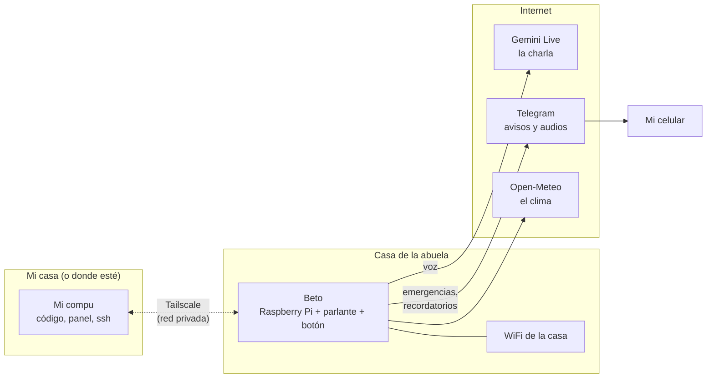
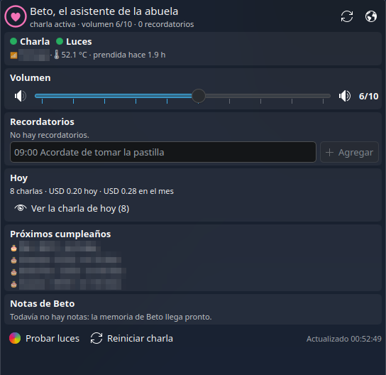

# Asistente para abuela
**Un compañero de voz con un solo botón, para que mi abuela charle, pregunte y pida ayuda sin tocar un celular.**

Se llama Beto. Es un parlantito con un anillo de luces, un botón y una ruedita de volumen. Adentro tiene una Raspberry Pi que conversa con ella usando Gemini, le recuerda cosas, le cuenta el clima y, si algo pasa, me avisa por Telegram.

> *Pronto: foto del aparato y un video de una charla.*

---

## Un día con Beto

**A la mañana** se pone lila y le recuerda la pastilla. **Durante el día** ella toca el botón y le pregunta el clima, las noticias o le pide la radio. **Si pasa algo**, mantiene apretado el botón y me llega un aviso por Telegram.

---

## Cómo lo cuido desde lejos

Beto vive en la casa de mi abuela y yo en la mía. Las dos computadoras están en una red privada con **Tailscale**: desde mi compu entro a la Pi como si estuviera al lado, sin abrir puertos en el router de nadie.

- **Telegram** me avisa en el celular: emergencias, recordatorios que no confirmó, o que quiere que la llame. Y la familia le puede mandar textos o audios al bot: Beto se los dice en voz alta, y ella contesta hablando.
- **Desde la compu** cambio recordatorios, ajusto cómo habla o actualizo el código, y lo copio a la Pi con un comando.
- **En el escritorio** tengo un widget que me muestra cómo está Beto sin abrir nada: si la charla y las luces andan, el volumen, los recordatorios, cuánto gastó hoy y los próximos cumpleaños. Desde ahí también cambio el volumen, agrego o borro recordatorios y apago la radio.

El widget en el escritorio KDE (los datos personales están tapados).

**La privacidad, en serio:** las claves y los datos de la familia viven solo en la Pi, con permisos que solo puede leer su usuario. A la Pi se entra únicamente con una llave. Lo que se habla queda en el registro del aparato una semana y después se borra solo. Nada de eso está en este repositorio.

---

## Lo que tiene adentro

| Parte | Para qué |
|---|---|
| Raspberry Pi Zero 2 W | La computadora (Linux) |
| ReSpeaker 2-Mics Pi HAT v2.0 | Dos micrófonos y la salida al parlante |
| Parlante chico | La voz de Beto |
| 16 LEDs WS2812 en anillo | Los colores de cada estado |
| Un botón | Hablar, confirmar y emergencia |
| Encoder rotativo | El volumen |
| Carcasa impresa en 3D | Para que quede lindo en la mesa de luz |

**Cuánto cuesta por mes:** Telegram, Tailscale (uso personal) y Open-Meteo son gratis. Gemini se paga por uso: con unas tres charlas por día, alrededor de **USD 4 al mes**. El aparato anota lo que gasta cada charla.

### Los colores

| Luz | Qué está haciendo |
|---|---|
| 🩷 Rosa respirando | Esperando |
| 🔵 Azul | Escuchando |
| 🔵 Azul girando | Pensando (consulta el clima o las noticias, cambia el volumen) |
| 🟢 Verde | Hablando |
| ⚪ Barra blanca | Volumen |
| 🟣 Lila | Recordatorio |
| 🩷 Punto rosa girando | Suena la radio |
| 🟠 Naranja | Sin internet o algo falló |
| 🔴 Rojo | Emergencia |

---

## Para quien lo quiera armar

El paso a paso técnico está en [docs/como-funciona.md](docs/como-funciona.md). En corto:

- `asistente/`: el programa que corre en la Pi (charla, luces, emergencia, recordatorios, clima, volumen).
- `asistente/prompt/base.md`: cómo habla y qué puede hacer. Se edita como texto, sin tocar código.
- `ejemplos/`: plantillas de la configuración privada (claves, perfil, familia, recordatorios).
- `pruebas/`: los programitas de las primeras etapas (botón, Telegram, voces).
- `desplegar.sh`: copia el código de la compu a la Pi y reinicia.
- `widget-plasma/`: un widget para el escritorio KDE Plasma que muestra cómo está Beto y deja cambiar el volumen y los recordatorios. Se instala con `kpackagetool6 -t Plasma/Applet -i widget-plasma/local.betopanel`.

Lo construí de a una etapa por vez: primero que suene y que el botón ande, después Telegram, la charla, las luces, la emergencia y que arranque solo. Cada etapa se podía probar antes de pasar a la siguiente.
